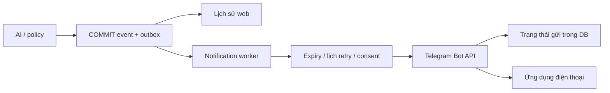

# Thông báo điện thoại qua Telegram — 02/11/2026

## Phạm vi đã chọn

Operator chọn Telegram, cho phép ảnh camera và muốn báo cả người quen/lượt ngắn
chưa xác định. AI, điều kiện còi, enrollment, calibration và giao thức ESP32 giữ
nguyên. Không triển khai Web Push/PWA song song trong đợt này.

Telegram dùng client trên điện thoại để nhận thông báo khi web đóng. Tài khoản
nhận cần mở bot và Start. Bot riêng cho hệ thống tránh xung đột với webhook hoặc
consumer khác; ghép bằng deep link có mã ngẫu nhiên, chỉ nhận đúng `/start <mã>`
trong private chat, không chọn người gửi gần nhất tùy ý.
[Telegram deep linking](https://core.telegram.org/bots/features#deep-linking).

Web Push là một hướng khác: cần subscription từng thiết bị, Push API và service
worker; iOS/iPadOS hỗ trợ Home Screen web apps từ 16.4 và yêu cầu thao tác người
dùng khi xin quyền. Cài PWA hiện có không tự tạo push.
[WebKit](https://webkit.org/blog/13878/web-push-for-web-apps-on-ios-and-ipados/),
[MDN Push API](https://developer.mozilla.org/en-US/docs/Web/API/Push_API).

## Luồng xử lý và điều kiện gửi



| Sự kiện | Gửi khi | Ảnh |
|---|---|---|
| `unknown_approach` | Alarm event theo policy hiện có | Evidence event nếu còn |
| `unresolved_presence`, `capacity_exceeded` | Warning event | Evidence event nếu có |
| `known_visit` | `notify_known_visits=true` | Ảnh tại sự kiện |
| `visit_completed`, identity UNCERTAIN/UNKNOWN | `notify_unresolved_visits=true`, lượt chưa có thông báo trước đó | Ảnh đại diện của chính lượt |
| `visit_completed`, identity KNOWN | Không gửi lặp sau known visit | Không tạo ảnh thêm |
| `notification_test` | Admin bấm Gửi thử, có CSRF/idempotency/rate limit | Checkbox ảnh mới nhất, nếu được phép |

Warning sau đó nâng thành alarm vẫn có thông báo riêng vì mức cảnh báo thay đổi.
Completion không lặp lại thông báo trước đó của cùng lượt. Test được đánh dấu
`system_test`, không phải phát hiện AI, không tạo lệnh còi hoặc tự ARM.

Ảnh đại diện giữ trong RAM tối đa bằng số người đồng thời được cấu hình, một ảnh
mỗi visit; ưu tiên ảnh có mặt/khớp tốt, làm mới khi ảnh ưu tiên quá cũ. Không tạo
thêm hàng đợi inference. Khi hoàn tất mới lưu evidence theo retention hiện có.
Revision/visit tách biệt; STOP/disarm/gallery change/reset xóa cache. Không dùng
ảnh phòng trống hiện tại thay cho người đã rời camera.

## Gửi, retry và trạng thái

- `pending`: đang chờ lần gửi đủ điều kiện; `sending`: đã ghi nhận lần thử trước
  I/O; `sent`: Telegram trả thành công và message ID. Đây **không phải** xác nhận
  người dùng đã đọc hay điện thoại đã hiện banner.
- `failed`: lỗi xác định hoặc hết số lần retry; `unknown`: không đủ căn cứ biết
  provider đã nhận; `expired`: quá hạn; `disabled`: tắt gửi; `cancelled`: đã hủy.
- Worker riêng, không HTTP/sleep retry trong coordinator lock. Alarm ưu tiên
  trước warning và info. `next_attempt_at` lưu bền; một row chờ retry không giữ
  chân những row đến hạn khác, trừ cooldown Telegram áp dụng cho cả người nhận.
- HTTP 429 tuân `retry_after`, kể cả hơn 60 giây; không cắt xuống để gửi sớm.
  Telegram khuyên tránh hơn một tin/giây trong một chat; worker chạy mỗi giây.
  [Bot API](https://core.telegram.org/bots/api#responseparameters),
  [Bots FAQ](https://core.telegram.org/bots/faq#my-bot-is-hitting-limits-how-do-i-avoid-this).
- Retry tối đa theo YAML; quá expiry thì không phát lại cảnh báo cũ. 401/403 là
  lỗi cấu hình/quyền, không retry vô hạn. Photo bị từ chối rõ ràng có thể fallback
  sang text; mất phản hồi không tự kết luận ảnh đã bị từ chối.
- Timeout có thể xảy ra sau khi Telegram đã nhận. Retry hữu hạn có thể tạo tin
  trùng; lưu `duplicate_possible`, dùng event ID để đối chiếu. Không có bảo đảm
  exactly-once từ implementation này. Đây là giới hạn suy ra từ khoảng mất xác
  nhận giữa network và COMMIT DB, không phải khẳng định Telegram trả read receipt.
- Restart khi row đang sending, hoặc lỗi lưu kết quả sau I/O: chuyển unknown,
  không gọi lại âm thầm như một lần chưa từng gửi.
- `sendPhoto` trả Message khi thành công, caption tối đa 1024 ký tự; ảnh VGA của
  hệ thống nằm dưới giới hạn hiện tại của API. Không gửi URL media công khai.
  [Telegram sendPhoto](https://core.telegram.org/bots/api#sendphoto).

## Cấu hình và bí mật

Mặc định repository đều tắt. Trong private hardware YAML, khi operator đã thiết
lập xong, chọn:

```yaml
notifications:
  telegram_enabled: true
  telegram_include_photos: true
  notify_known_visits: true
  notify_unresolved_visits: true
```

Token/chat lấy từ environment riêng: `SSS_TELEGRAM_TOKEN`, `SSS_TELEGRAM_CHAT`.
Ảnh còn cần `SSS_TELEGRAM_PHOTO_CONSENT=1`; thiếu quyền thì chỉ gửi text. Đặt
`SSS_DASHBOARD_URL` là HTTPS URL của dashboard, không query/token/userinfo.
Thông báo chỉ chứa mô tả, thời gian UTC+7, event ID, ảnh đã cho phép và link web;
không gửi embedding, token, cookie hay tên từ gallery.

`tools.telegram_setup` nhập token bằng getpass, chuyển bằng SSH stdin với host
key được kiểm tra, không đưa token vào argv/script sinh ra. Bot được kiểm tra
bằng getMe/getWebhookInfo; không xóa webhook của bot đang dùng chung. Ghép đúng
mã Start trong private chat rồi ghi `telegram.env` quyền600, không ghi đè nếu
chưa có `--replace`. Công cụ chỉ chuẩn bị bí mật, không gửi tin/ảnh hoặc bật tự
động. Không dán token vào chat/Git hay chụp token để báo cáo.

HTTPX log đã che bot token; exception provider chỉ thành reason code hữu hạn.
API status trả readiness/queue/error nhưng không trả token/chat ID. Dashboard,
ảnh và liên kết vẫn cần đăng nhập; không mở camera công khai.

Xóa người: hủy pending, chuyển delivery đang chạy sang chưa xác định, xóa ảnh
local/cache. Một request đã bắt đầu có thể đã rời server; không giữ lock mạng
để chặn STOP. Ảnh đã tới Telegram và backup cũ cần operator xóa riêng, không
được mô tả thao tác xóa local là thu hồi mọi bản sao bên ngoài.

## Migration, kiểm tra và triển khai

`003_notification_delivery.sql` thêm bảng companion và cooldown, giữ nguyên sáu
cột outbox cũ. FK xóa metadata cùng outbox/event. Code cũ đọc các bảng cũ được;
khi rollback binary phải **giữ migration003** để migration ledger vẫn khớp. Không
chép DB/embedding lên máy khác để triển khai. Profile hash không chứa cấu hình
notifications nên việc bật thông báo không tự làm mất calibration đã duyệt.

Test phủ: định tuyến known/completion, ảnh đúng visit và reset, auth/CSRF,
idempotency/test rate limit, không tạo còi, thiếu token/consent, photo/text,
401/403/429/5xx/timeout, expiry/retry cap/restart/lỗi COMMIT, provider chậm không
giữ STOP, xóa người trong I/O, token log, secure setup. Tất cả provider trong
unit tests là mock, không phải bằng chứng điện thoại đã nhận.

Nghiệm thu thật sau triển khai:

1. Người nhận Start bot, cấu hình được nạp; web hiển thị đúng chế độ ảnh/sự kiện.
2. Admin bấm **Gửi thử Telegram**; xác nhận trên điện thoại khi web đóng/màn hình
   khóa và khi dùng mạng di động, kiểm mute/Do Not Disturb/quyền Telegram.
3. Gửi thử có ảnh mới, mở nút link: đăng nhập được, video/lịch sử đúng, không có
   token trong URL. `sent` trong DB đối chiếu tin/ảnh thực tế.
4. Một lượt người quen và một lượt chưa xác định ngắn: đúng loại thông báo, không
   lặp completion, ảnh không phải người/lượt trước; vẫn giữ chính sách còi.
5. Lỗi mạng/provider: core tiếp tục, trạng thái lỗi/expiry/unknown đúng; STOP
   hoạt động. Không đánh dấu gửi thành công vì chỉ thấy row đã được xếp hàng.

Không thể bảo đảm banner/sound điện thoại 100% nếu máy mất mạng, chặn bot, tắt
thông báo hoặc OS hạn chế. Báo riêng provider accepted, operator received và
luồng AI/thiết bị thực; không tự đánh dấu toàn bộ HIL đạt.

## Hiện trạng triển khai 02/11/2026

- Oracle đã nạp bot/người nhận từ file riêng quyền600 và bật bốn cờ nêu trên
  lúc 17:01 (UTC+7). UI mới có trạng thái Telegram và nút gửi thử, cache được đổi
  phiên bản. Không gửi lại 30 thông báo cũ đã disabled.
- Readiness đạt; API trạng thái/ảnh/gửi thử từ chối truy cập chưa đăng nhập.
  Calibration, model và gallery một người/10 mẫu giữ nguyên; restart DISARMED.
- Local `tools.check --http`: **178 passed, 2 skipped** (hai test POSIX), lint,
  format, JavaScript và HTTP/video/auth đạt. Linux: **179 passed, 1 skipped**
  (Node không có), lint/format/HTTP đạt; test POSIX setup thực chạy ở Linux.
- Trước lần kiểm tra cuối, local gặp timeout test video do ảnh synthetic có thể
  trùng timestamp nhận trong cùng millisecond; test đã cấp timestamp tăng riêng,
  không thay deadline hoặc guard production. Một lần smoke WebSocket trước đó
  timeout; lần độc lập và lần gate cuối đều đạt, không nới timeout để qua test.
- Người dùng đã xác nhận ghép bot/Start và nhận tin thử, ảnh, mở link web thành
  công. DB đối chiếu một `notification_test` gửi `photo`, một lần thử, có provider
  message ID, không đánh dấu khả năng trùng. Đây là kiểm chứng kênh thật.
- Sau đó operator bật giám sát và thực hiện các lượt mặt rõ/khẩu trang, xác nhận
  thông báo tự động **đúng loại, đúng ảnh, không lặp**. Đối chiếu DB tại 17:05:
  hai `known_visit`, bốn `visit_completed` và một tin thử đã gửi ảnh thành công.
  Đây là bằng chứng luồng Telegram của phiên demo, không phải số đo accuracy AI.
- Màn hình khóa/mạng di động và thử lỗi mạng thiết bị thực chưa được xác nhận
  riêng; unit test không thay nghiệm thu các điều kiện đó.
